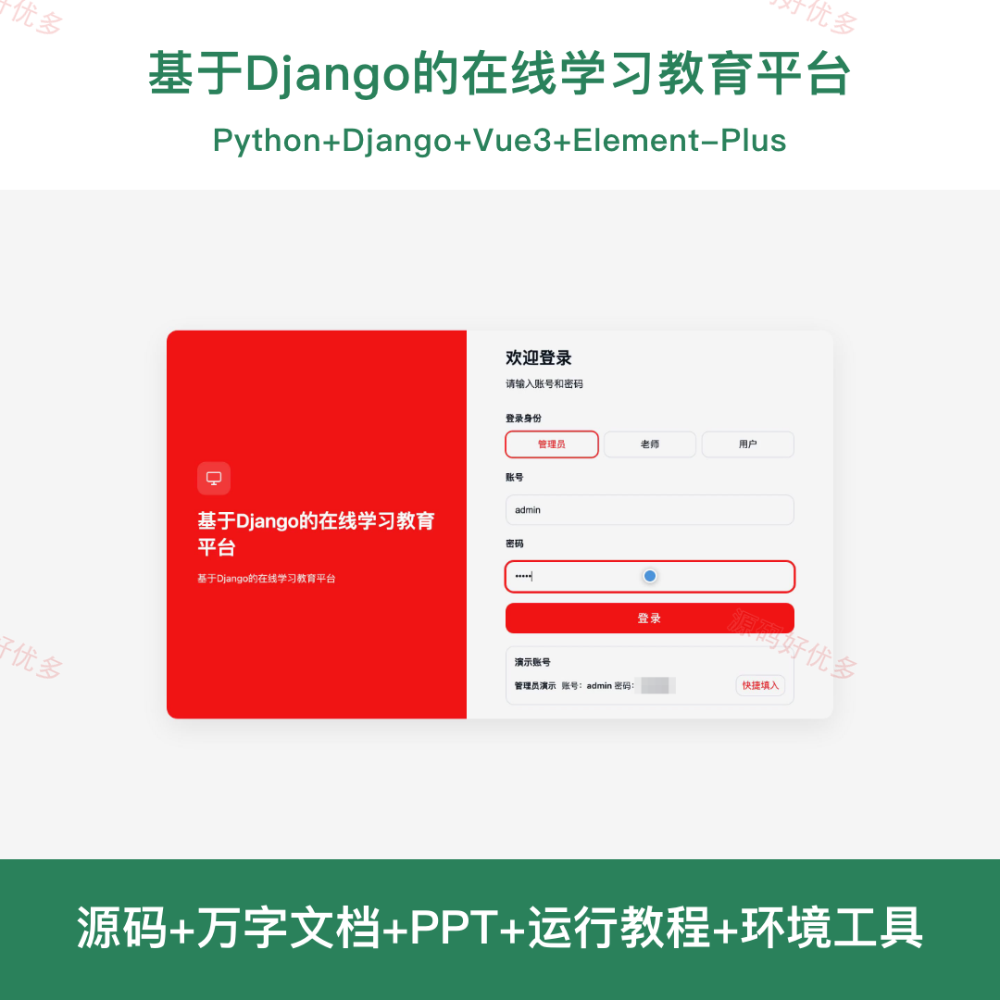
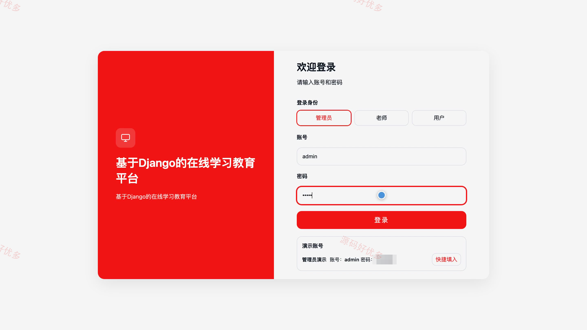
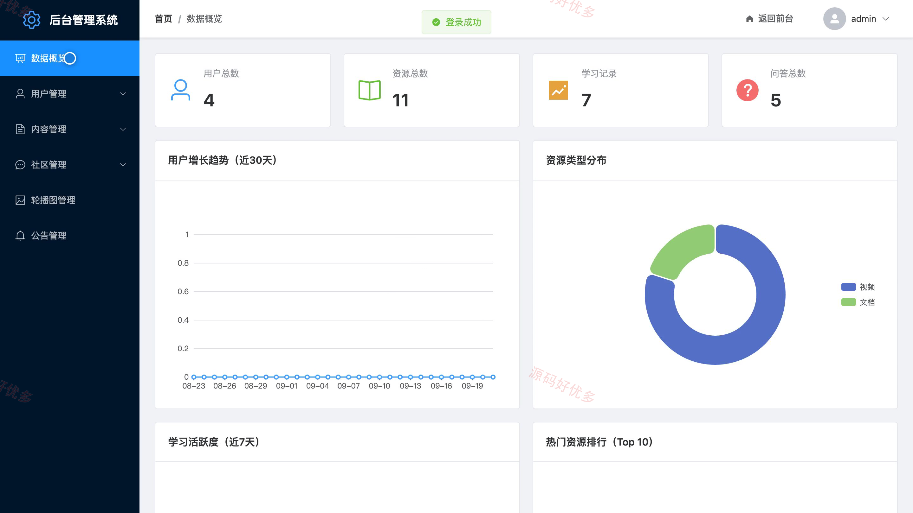
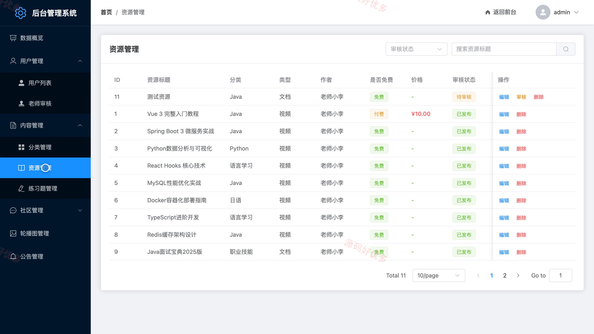
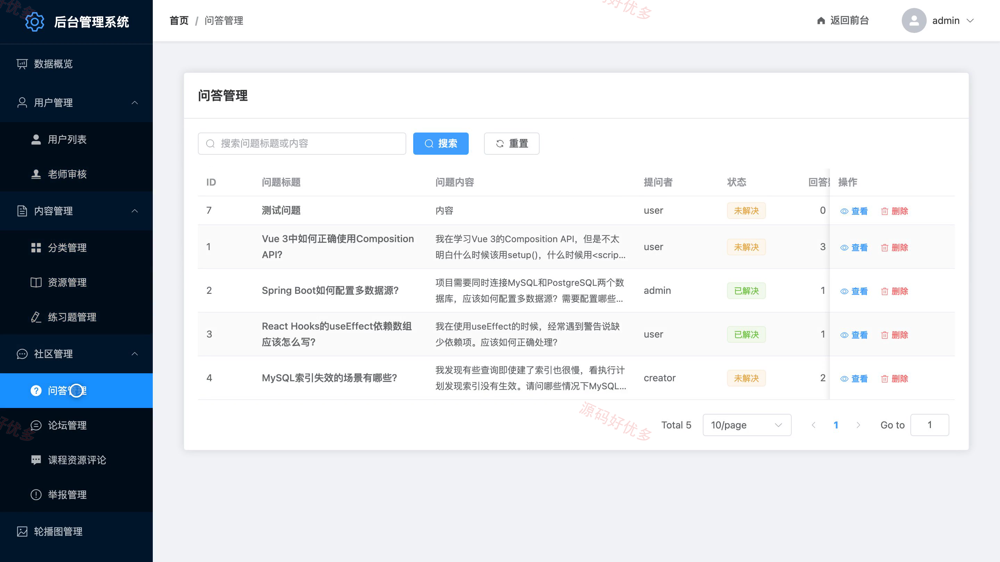
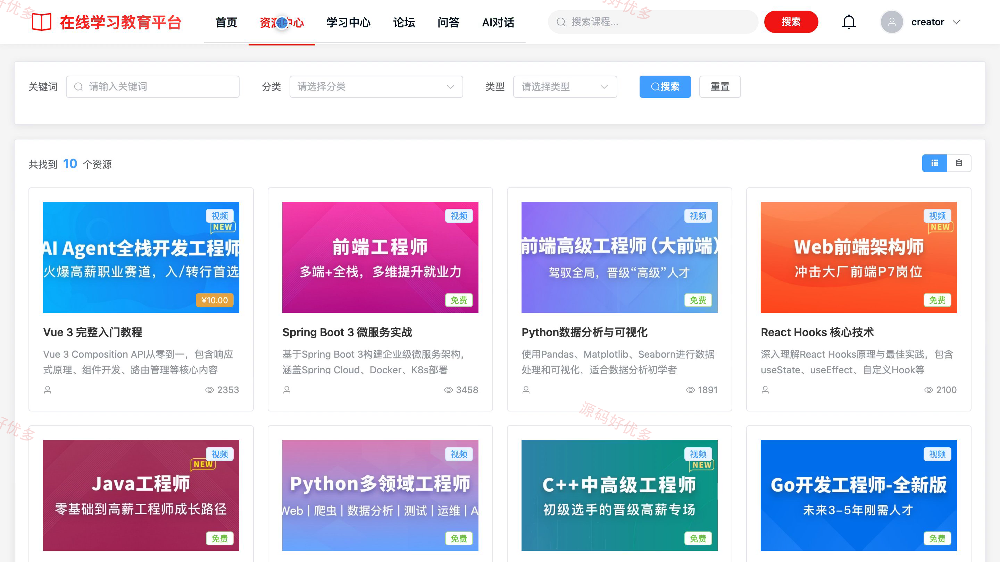
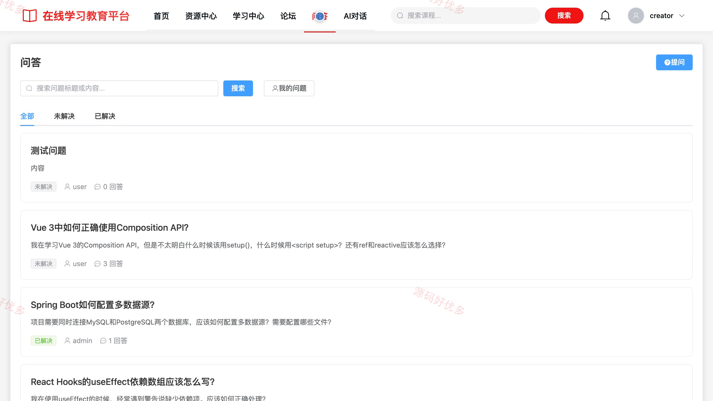
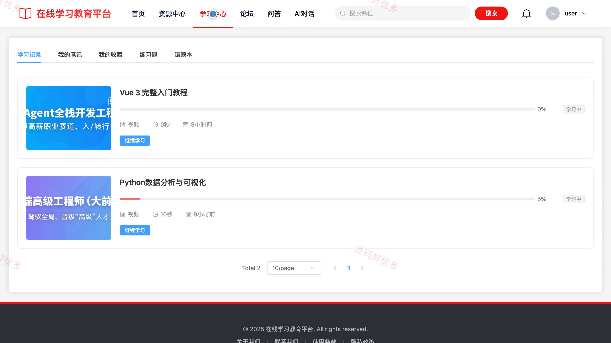

# bs126C
bs126C在线学习教育平台
## 源码问题查看主页咨询

### 一、关键词
在线学习、网络课程、教育资源、随堂练习、学习社区

### 二、作品包含
源码+数据库+万字设计文档+PPT+全套环境和工具资源+本地部署教程

### 三、项目技术
前端技术： Html、Css、Js、Vue3.4、Element-Plus
后端技术：Python、Django

### 四、运行环境要求
开发工具：PyCharm + VSCODE

数据库：MySQL5.7+（共28张表）

数据库管理工具：Navicat10以上版本

环境配置软件： Python3+

前端Nodejs：16+

浏览器：谷歌浏览器

### 五、项目介绍
项目编号：bs126C

本平台面向学习用户、老师和管理员，提供课程资源浏览、购买学习、随堂练习、学习笔记、交流问答、AI 学习对话和资源审核管理等功能。

角色：用户、老师、管理员

用户功能：浏览与检索学习资源、购买资源并充值余额、在线学习并完成随堂练习、收藏资源和记录学习笔记、参与论坛讨论与问答交流、使用 AI 学习对话、查看公告消息并维护个人资料、申请成为老师。

老师功能：上传和管理教学资源、查看我的资源及审核状态、管理资源随堂练习。

管理员功能：查看平台数据概览、管理用户并审核老师认证、审核教学资源并维护分类、管理练习题和问答内容、管理论坛帖子与评论、维护轮播图和系统公告、处理内容举报。

### 六、运行截图

